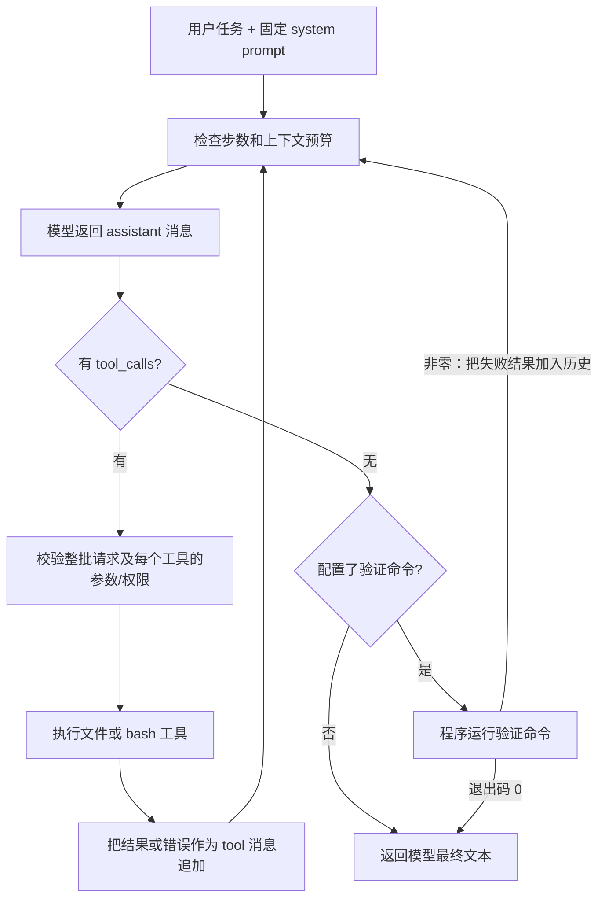

# Agent Lab · 从循环开始理解 Agent

一个可以阅读代码、修改文件、执行测试的 Python Coding Agent。参考《Agent 解剖课》的最小循环与 harness 思路，用中文注释说明每个关键决策。

**先运行离线演示，再接入真实模型。** 核心代码只用 Python 标准库，运行不需要安装第三方依赖。Python 3.11+；包含 bash 的演示和命令执行需要 macOS、Linux 或 WSL。

## 1. 一分钟运行

```bash
git clone https://github.com/Tommy-Ge/agent-lab.git
cd agent-lab
python3 -m agent_lab demo
```

这是私有仓库，克隆时需使用有访问权限的 GitHub 账号。也可以在仓库的 Code 菜单下载 ZIP，解压后进入项目目录。

演示会在一个新的临时目录创建 `stats.py` 和三个测试，展示以下过程：

```text
修复前：mean([2, 4, 6]) 结果不正确，mean([7]) 触发除零
第 1 轮：list_files + read_file（一次回复包含两个工具请求）
第 2 轮：edit_file，把 len(values) - 1 改成 len(values)
第 3 轮：bash，执行实际的 Python unittest
第 4 轮：输出最终文本 → 程序再次运行验证命令
修复后：3 个测试通过，保存完整 JSONL 轨迹
```

**离线演示使用预先写好的动作脚本，不是真实 LLM，不证明模型的编码能力。** 文件修改、工具执行、消息循环和测试都是真实的，和真实模式共用同一套 harness。演示目录会保留，路径显示在终端，方便查看修改和日志。

## 2. 接入真实模型

选择支持 **Chat Completions + function calling** 的服务端。配置项也可用于提供相同协议的本地服务；不同服务商的扩展字段和模型行为仍需要实际联调。

在当前终端设置：

```bash
export AGENT_BASE_URL='https://api.openai.com/v1'
export AGENT_MODEL='填写你账号可用且支持工具调用的模型ID'
# 在本机设置 AGENT_API_KEY，不要把密钥贴到聊天或提交到仓库。
# .env.example 提供字段示例；程序不会自动加载 .env。
```

在 macOS 默认 zsh 中，可以隐藏输入密钥，避免把明文写进命令历史：

```zsh
read -s 'AGENT_API_KEY?请输入 API key：'; echo
export AGENT_API_KEY
```

只读地理解本项目：

```bash
python3 -m agent_lab run '阅读 agent_lab/agent.py，用中文解释每一轮消息如何变化' \
  --workspace .
```

允许修改工作区文件：

```bash
python3 -m agent_lab run '阅读代码，为指定函数补充说明，不改变逻辑' \
  --workspace /你的项目绝对路径 \
  --allow-write
```

在练习目录中修 bug，并要求通过验证门：

```bash
# 每次先复制一份练习，原始样例留作对照。
cp -R examples/buggy_stats /tmp/agent-lab-my-exercise
python3 -m agent_lab run '修复 mean 的错误，保留测试，运行测试后总结' \
  --workspace /tmp/agent-lab-my-exercise \
  --allow-write --allow-shell \
  --verify 'python3 -m unittest -v'
```

`--allow-shell` 允许以当前用户权限执行任意 bash 命令。它可以修改文件，**即使没传 `--allow-write`**。请在可信、可恢复的练习项目中启用；需要操作系统隔离时应自行放进容器或虚拟机。

如果已有本机推理服务，根地址可设成 `http://127.0.0.1:8000/v1`。此时允许不设密钥，但具体模型和 tool-call parser 由你部署的服务决定。本项目不下载或启动模型。

可选安装成命令（需要 setuptools 安装依赖）：

```bash
python3 -m pip install -e .
agent-lab --help
```

## 3. Agent 到底在哪里



模型决定“接下来调用什么工具”。Python 程序负责执行和限制。你改 system prompt，会影响策略；你改工具和验证门，会改变模型能做什么、何时算完成。

推荐阅读顺序：

| 文件 | 读完要能回答的问题 |
| --- | --- |
| [`agent_lab/agent.py`](agent_lab/agent.py) | 循环何时继续、何时停止？为什么先追加 assistant？ |
| [`agent_lab/tools.py`](agent_lab/tools.py) | 工具 schema 是什么？参数、权限和异常在哪检查？ |
| [`agent_lab/llm.py`](agent_lab/llm.py) | HTTP 请求在哪里发？如何切换模型服务商？ |
| [`agent_lab/storage.py`](agent_lab/storage.py) | 一条轨迹如何落盘？长输出怎样取回来？ |
| [`agent_lab/demo.py`](agent_lab/demo.py) | 为什么没有 API key 也能测试 harness？ |
| [`agent_lab/cli.py`](agent_lab/cli.py) | 命令行参数如何影响实际权限和运行限制？ |
| [`docs/代码导读.md`](docs/代码导读.md) | 把上述模块连起来，逐轮解释消息与验证门。 |

## 4. 已实现的工具和约束

| 工具 | 用途 | 权限 |
| --- | --- | --- |
| `list_files` | 查看目录直接子项 | 默认可用 |
| `read_file` | 按行读取 UTF-8 文件，带行号 | 默认可用 |
| `edit_file` | 精确替换唯一匹配的原文 | `--allow-write` |
| `write_file` | 创建新文件，拒绝覆盖 | `--allow-write` |
| `bash` | 独立子进程运行命令，返回退出码及合并输出 | `--allow-shell` |
| `read_output` | 按字符分页取回本次运行的长输出 | 默认可用 |

- 文件工具限制在工作区，拒绝 `..`、符号链接和常见凭据路径。路径规则是基本防误操作措施，不是对抗恶意并发修改的文件系统沙箱。
- 默认是只读模式；“只读”针对项目文件，程序仍会创建自己的 `.agent-lab` 日志。
- 单文件读写上限 1 MB，命令捕获输出上限 1 MB。超过输出上限或超时会终止进程组；超过捕获上限的部分无法恢复。
- 工具观测默认只发送最多约 6000 字符；更长的**已捕获输出**保存在本地，通过 `read_output` 按 ID 取回。
- 历史只追加、不清除错误、不做自动摘要。默认最多 20 次模型调用；消息和工具 schema 的序列化字符预算为 60000。字符数不是 token 数，也不是费用预算。
- 模型正常输出最终文本才会进入结束阶段；空响应、重复调用 ID、生成截断都不会当作成功。
- `completed` 表示模型给出最终文本，且已配置的验证门通过。没有验证门时，不代表有独立证据证明任务正确。

## 5. 测试与轨迹

```bash
python3 -m unittest discover -s tests -v
```

32 项测试覆盖工具 ID 配对、多工具请求、append-only、错误恢复、上下文及步数停止、验证门、越界路径、符号链接、参数类型、超时、输出限制、HTTP 适配器和完整离线演示。GitHub Actions 会在 Python 3.11–3.14 上运行同样的测试与演示，不需要 API key。

每次运行的记录在指定工作区中：

```text
.agent-lab/runs/<时间-随机ID>/
├── trace.jsonl          # run_start / model_request / model_response / tool_result / verification / run_end
├── summary.json        # 最终状态、调用次数、答复及完整消息
└── output-0001.txt      # 有长输出时才生成，可用 read_output 读取
```

`model_request` 记录尝试发起的请求；`model_response` 只记录成功收到的响应。网络失败时，两者数量可能不同。`steps` 统计尝试调用模型的次数。usage 原样记录服务端返回值，离线脚本不编造 token 数。

退出码：`0` 表示 `completed`；`1` 表示达到限制、模型错误或中断；`2` 表示配置/入口错误。达到上限不会静默声称成功。

日志可能包含任务、源代码和工具输出，默认由 `.gitignore` 排除。程序不记录 Authorization 或 API key，也不把这些变量传给 bash；这不等于对日志中任意业务秘密进行自动脱敏。

## 6. 这版的范围

这版完成教程中的最小循环、基本工具、长输出落盘、权限开关、轨迹记录与命令验证门。它是学习和小任务实验的起点。

尚未实现：自动 compaction、跨会话恢复、多 Agent 调度、独立 LLM evaluator、VLA/LIBERO 接口和训练。阅读 [`docs/后续实验.md`](docs/后续实验.md) 可以逐项扩展和做消融，避免把未验证组件堆进第一版。

本仓库的自动化测试验证 harness 与接口契约，**尚未使用你的真实模型账号做在线验证**。真实任务的质量、费用与模型兼容性需要在配置账号后检查；本程序也没有精确 token 预算、自动重试或用量计费功能。

接口参考：[官方 Function calling 文档](https://developers.openai.com/api/docs/guides/function-calling)。本实现选用 Chat Completions 兼容协议以对应教程的 `assistant/tool/tool_call_id` 示例；并不代表所有模型或服务商都支持完全相同的字段。
